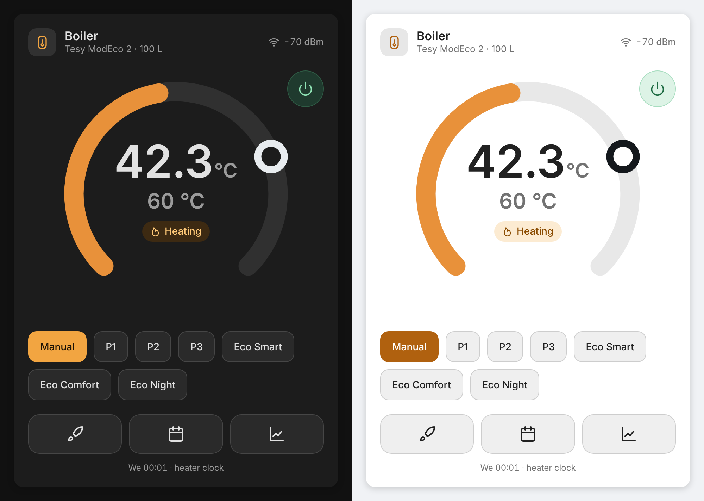
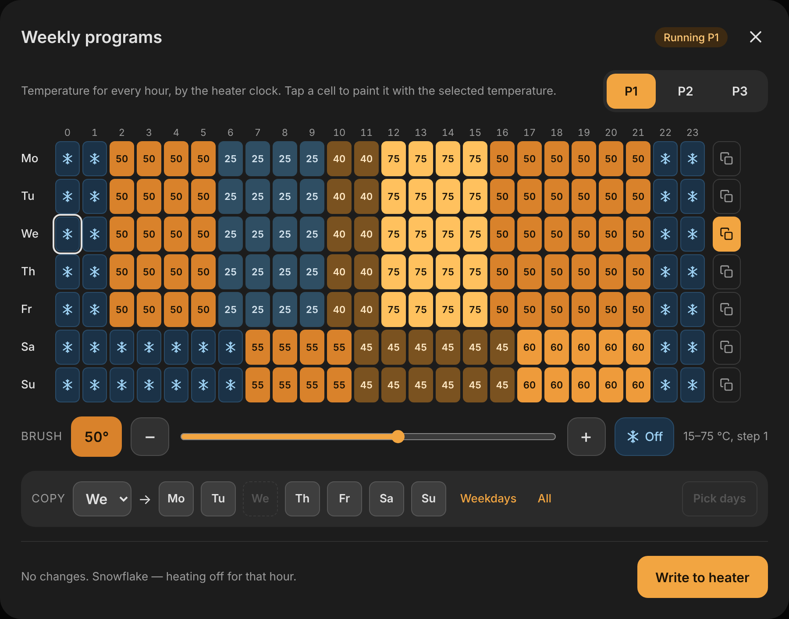
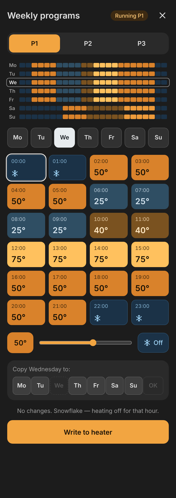
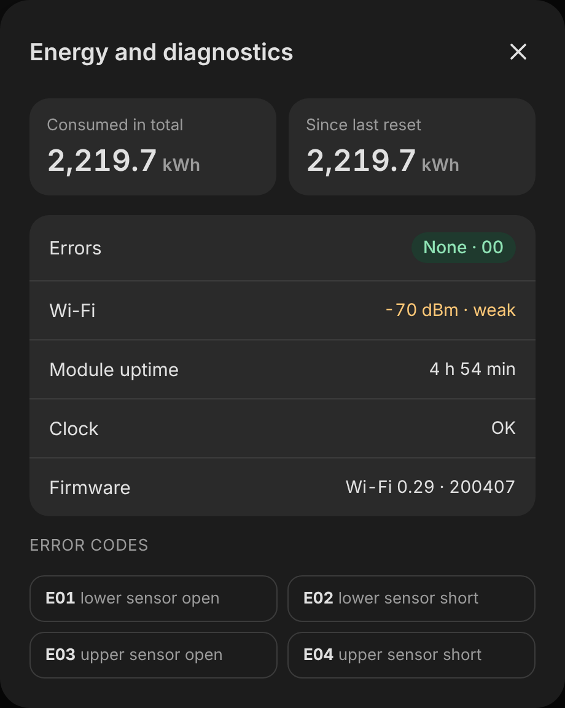

# Home Assistant Tesy integration

This unofficial Tesy integration allows you to control smart wifi devices based on external esp32 wifi module (black pcb).
It won't work if you have older device based on Atheros AR9331 chipset since the local API is different. In this case the module could be replaced with esp32 replacement module as they are compatible with most of Tesy water heaters, even if not comming with WiFi from the factory.

Tested with:

- [Tesy Modeco Cloud GCV 150 47 24D C22 ECW](https://tesy.com/products/electric-water-heaters/modeco-series/modeco-cloud/?product=gcv-1504724d-c22-ecw)
- BilightSmart
- BelliSlimo
- [Tesy BelliSlimo Cloud GCR 80 27 22 E31 ECW](https://tesy.com/products/electric-water-heaters/bellislimo-series/bellislimo-cloud/?product=gcr-80-27-22-e31-ecw)

## Highlights

This integration allows you to change modes of the water heater as well as controlling the temperature setpoint in manual mode (defined as Performance in HA).

Energy counter is also working. It uses long term counter from the device that counts the seconds the heater was on. In order for this to work properly you need to enter your heater power rating in the setup dialog. This information could be found on the device's label. For double tank devices this is read from the device and leaving it as zero is recommended.

The integration provides two energy sensors: `Energy Consumed` tracks total lifetime usage. `Energy Consumed (Resettable)` uses the device's built-in resettable counter - a `Reset Consumed Energy` button is provided to reset it, like a trip odometer.

This integration exposes boost mode of the heaters as a switch. It can be switched on and off, but in order to work the heater should on.

Child lock switch prevents accidental changes (if supported by the device).

Temperature setpoint is only used in manual (Performance) mode. In any other modes it is ignored. If setpoint is manually changed operation mode will jump to performance in case the heater is powered on.


## Poll interval

The heater is read every 30 seconds by default, so changes made on its panel or in the MyTESY app show up in Home Assistant within that time. To make it faster, open the integration → **Configure** and set **Poll interval** (5-300 s); 10 s is a good value for a local device. After any command from Home Assistant the heater is also read again ~2 s later, so the heating state and target follow right away. This works on every model.

## Thermostat card

The card is served by the integration and registered as a dashboard resource by itself — nothing to install or add under *Resources*. It is registered once a supported heater (so far the ModEco 2, see *Weekly programs*) is set up; on another model it shows a notice instead of the controls. After installing or updating the integration, restart Home Assistant and reload the browser once (Ctrl+F5; in the companion app: Settings → Debugging → Clear frontend cache).



Add it from **Add card → Tesy boiler**, or with YAML:

```yaml
type: custom:tesy-boiler-card
entity: water_heater.boiler_modeco_2_heater
# optional
name: Boiler
subtitle: ModEco 2 · 100 L
animation: auto     # auto (off when the system asks for reduced motion) | always | off
auto_reload: true   # reload a page that still runs an older card after an update
```

- **Dial** with the current water temperature and the active target. In manual mode a handle on the dial sets the setpoint (15–75 °C); other modes show the target they work to.
- **Power** button at the top right of the dial; **modes** Manual, P1–P3, Eco Smart/Comfort/Night; **Boost**, **schedule** and **statistics** as icon buttons.
- Heating status (heating / target reached / heating off / off) with a subtle animation while the element heats.
- The clock line under the buttons shows the heater's own time; a warning appears when its time zone or clock is off.
- Follows the Home Assistant light/dark theme and UI language: English and Ukrainian; any other language gets English (numbers keep the UI language format).

Related entities (Boost switch, energy and diagnostic sensors, clock sensor, time zone button) are found automatically on the same device.

**Updates and caching.** On every start the integration keeps one resource, `/tesy_static/tesy-boiler-card.js?v=<hash>`, in Settings → Dashboards → Resources: the hash changes with the card, so an update gets a new URL. A resource added by hand for the same path is taken over; one pointing to another copy (in `/local`, say) is left alone with a warning in the log. With YAML-mode dashboards resources cannot be changed by an integration, so the card is added to every page instead. The resource is removed with the last heater. The card is served with `Cache-Control: no-cache` and an ETag, so browsers and reverse proxies (Cloudflare, nginx) check for a newer file on every page load. A page opened before Home Assistant restarted with a new card (a wall tablet, say) reloads itself once; if that does not help, the card shows a reload banner. A page that never loaded the card needs one manual reload.

### Card: schedule

The calendar button opens the weekly programs P1–P3. Each cell is one hour of one day, by the heater's clock.



- **Program tabs** P1–P3; the badge shows which program the heater runs now, and a frame marks the current heater hour.
- **Brush**: pick a temperature (15–75 °C, step 1) or ❄ *Off* (heating off for that hour, stored as 14 °C on the heater), then tap cells to paint them. Empty cells have no entry.
- **Copy**: choose a source day and copy it to other days, weekdays or the whole week.
- **Write to heater** saves only the changed days through `tesy.set_schedule` and returns to the card. While nothing is edited, the dialog follows changes made on the heater panel or in MyTESY.

On phones and portrait screens (narrower than 720 px) the same editor works day by day:



A mini-map of the week sits on top, then the day buttons and the 24 hours of the selected day as 4×6 tiles. The brush and *Copy &lt;day&gt; to* work as on the wide grid.

### Card: statistics

The chart button opens energy and diagnostics.



- **Energy**: total consumption and the resettable counter (since its last reset). The heater updates its own counter in hourly batches; for the Energy dashboard the integration adds heating time × configured power at every poll.
- **Errors**: current error code with a description (E01/E02 lower sensor open/short, E03/E04 upper sensor open/short).
- **Wi-Fi** signal in dBm, marked *weak* below −67 dBm.
- **Module uptime**, **clock** state (heater time and time zone compared with Home Assistant) and **firmware** versions.

## Installation

### Via HACS

[](https://my.home-assistant.io/redirect/hacs_repository/?owner=krasnoukhov&repository=homeassistant-tesy&category=Integration)

* Search for "Tesy" on HACS tab in Home Assistant
* Click on three dots and use the "Download" option
* Follow the steps
* Restart Home Assistant

### Manual Installation (not recommended)

* Copy the entire `custom_components/tesy/` directory to your server's `<config>/custom_components` directory
* Restart Home Assistant

## Entities

### Water Heater

| Entity | Attributes |
|--------|------------|
| `water_heater.heater` | `is_heating`, `target_temp_step` |

### Operation Modes

| Mode | Description |
|------|-------------|
| Off | Heater is powered off |
| Manual | Direct temperature control (default) |
| Program 1 | Schedule-based heating preset 1 |
| Program 2 | Schedule-based heating preset 2 |
| Program 3 | Schedule-based heating preset 3 |
| Eco Smart | Energy-saving mode |
| Eco Comfort | Balanced comfort and efficiency |
| Eco Night | Overnight energy-saving mode |

Custom icons are provided for Program 1-3 and Eco modes. Standard modes use core HA icons.

### Sensors

| Entity | Description | Device Class | Unit |
|--------|-------------|-------------|------|
| `sensor.temperature` | Current temperature / showers | `temperature` | °C |
| `sensor.energy_consumed` | Total energy consumed | `energy` | kWh |
| `sensor.ready_in` | Minutes until target is reached | `duration` | min |
| `sensor.target_temperature` | Active target temperature | `temperature` | °C |
| `sensor.error_status` | Error code (`00` = no error) | - | - |
| `sensor.wifi_signal` | WiFi signal strength | `signal_strength` | dBm |
| `sensor.uptime` | Device uptime | `duration` | s |
| `sensor.energy_consumed_resettable` | Energy consumed (since last reset from device) | `energy` | kWh |

### Switches

| Entity | Description |
|--------|-------------|
| `switch.boost` | Boost mode |
| `switch.child_lock` | Child lock (if supported) |

### Weekly programs

Weekly programs, the time zone sync below and the thermostat card are enabled per model, for models where they were verified: so far the ModEco 2 (id 2004, firmware 200407 / Wi-Fi 0.29). Other models keep the previous behaviour; the list is in [`features.py`](custom_components/tesy/features.py), and a model is added there once it has been tested. A feature is enabled only if the heater also reports the fields it needs (`prgP1MO` … `prgP3SU`).

On those heaters the water heater entity gets extra attributes:

| Attribute | Description |
|-----------|-------------|
| `schedule_p1` … `schedule_p3` | `{"mo": [24 values], …, "su": [...]}`, °C per hour from 00:00; `14` = heating off for that hour (snowflake in MyTESY), `null` = no program entry (not stored in history) |
| `active_program` | `1`-`3` while a program runs, otherwise `null` |
| `manual_temperature` | Setpoint kept for manual mode (`tmpT`) |
| `tesy_features` | Extended features enabled for this heater, e.g. `["card", "schedule", "timezone"]` (not stored in history) |

While a program runs, the target temperature (entity and `Target Temperature` sensor) is the one the heater reports in `tmpR`; it can already be the next hour's value while the heater warms up ahead of it. When the heater is idle in a program, the firmware reports a placeholder (`9`) there instead, and the target is taken from the program for the current hour of the device clock.

Programs can be written with the `tesy.set_schedule` action. Use 15-75 °C for a setpoint and `14` to switch heating off for an hour:

```yaml
action: tesy.set_schedule
target:
  entity_id: water_heater.heater
data:
  program: 3
  days: [mo, tu, we, th, fr]   # optional, all days if omitted
  temperatures: [14, 14, 14, 14, 14, 14, 60, 60, 60, 14, 14, 14, 14, 14, 14, 14, 14, 14, 60, 60, 60, 60, 14, 14]
```

Each day is a 24-byte hex string on the device and is written with `/api?name=prgP3MO&set=<48 hex chars>`.

### Clock and time zone

Weekly programs run on the heater's own clock. The module takes UTC from the network and converts it to local time with a POSIX TZ string in `tz` (e.g. `EET-2EEST,M3.5.0/3,M10.5.0/4`); the time itself cannot be set over the API, only `tz`.

On models with time zone sync enabled (see *Weekly programs*) the integration keeps `tz` in step with Home Assistant's time zone: on start-up and whenever the HA time zone changes it writes the matching POSIX string (taken from the tz database) if the heater differs.

| Entity | Description |
|--------|-------------|
| `binary_sensor.clock_problem` | On if `tz` differs from HA's zone or the heater clock is more than 5 minutes off HA (e.g. no internet). Attributes: `problems`, `device_time`, `offset_seconds`, `timezone`, `expected_timezone` |
| `button.sync_timezone` | Writes HA's time zone to the heater now |

If the clock is off with the right time zone, the module has no internet; set the time on the panel (hold **i** in standby) or restore the connection.

### Buttons

| Entity | Description |
|--------|-------------|
| `button.energy_reset` | Reset the resettable energy counter |

## Device API Parameters

| Field | Description | Used By |
|-------|-------------|---------|
| `pwr` | Power state | Water heater |
| `mode` | Operation mode | Water heater |
| `tmpC` | Current temperature / showers | Temperature sensor |
| `tmpT` | Target temperature setpoint | Water heater |
| `tmpR` | Active target temperature (in a program it can be the next hour's value; placeholder `9` while idle) | Target Temperature sensor |
| `date` | Device local time (read-only, only in `_all`) | Program target lookup, clock check |
| `tz` | POSIX time zone used for local time (writable) | Time zone sync |
| `prgP{1-3}{MO..SU}` | Weekly programs, 24 bytes hex per day, °C per hour, `FF` = empty | Schedule attributes, `tesy.set_schedule` |
| `ht` | Heating element active | `is_heating` attr |
| `bst` | Boost flag | Boost switch |
| `cdt` | Countdown timer (minutes) | Ready In sensor |
| `err` | Error code | Error Status sensor |
| `wdBm` | WiFi RSSI | WiFi Signal sensor |
| `wup` | Uptime (seconds) | Uptime sensor |
| `lck` | Child lock | Child Lock switch |
| `pwc_t` | Runtime counter | Energy calculation |
| `pwc_u` | Resettable runtime counter | Resettable Energy sensor |
| `parNF` | Additional parameters | Dual-tank energy calculation |
| `id` | Device type ID | Device detection |
| `MAC` | MAC address | Unique ID |
| `tmpMX` | Maximum showers | Max setpoint |
| `wsw` | Software version | Device info |
| `hsw` | Hardware version | Device info |

## API Details

The device exposes a local HTTP API at `http://{device_ip}/api`. You can retrieve all device parameters in a single request:

```
http://{device_ip}/api?name=_all
```   

This returns a JSON object with all fields listed in the table above.

## Supported Devices

| ID | Model | Range | Extended features |
|----|-------|-------|-------------------|
| 2000 | ModEco | 15-75°C | — |
| 2002 | BelliSlimo | 0-4 showers | — |
| 2003 | BiLight Smart | 15-75°C | — |
| 2004 | ModEco 2 | 15-75°C | weekly programs, time zone sync, card |
| 2005 | BelliSlimo Lite | 0-4 showers | — |

Extended features are enabled per model in [`features.py`](custom_components/tesy/features.py), once verified on that model; other models keep the basic behaviour.

## Translations

Available in 9 languages: English, Bulgarian, German, French, Dutch, Spanish, Italian, Turkish, Ukrainian. Operation modes, sensors, switches, buttons, and config flow are all translated. The thermostat card follows the Home Assistant UI language in English and Ukrainian and falls back to English.
